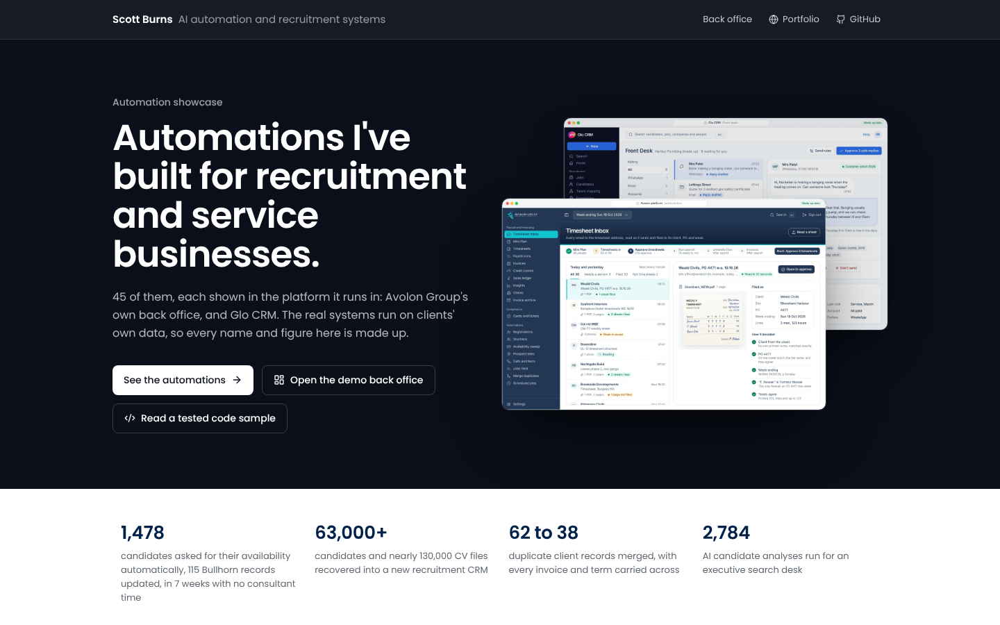
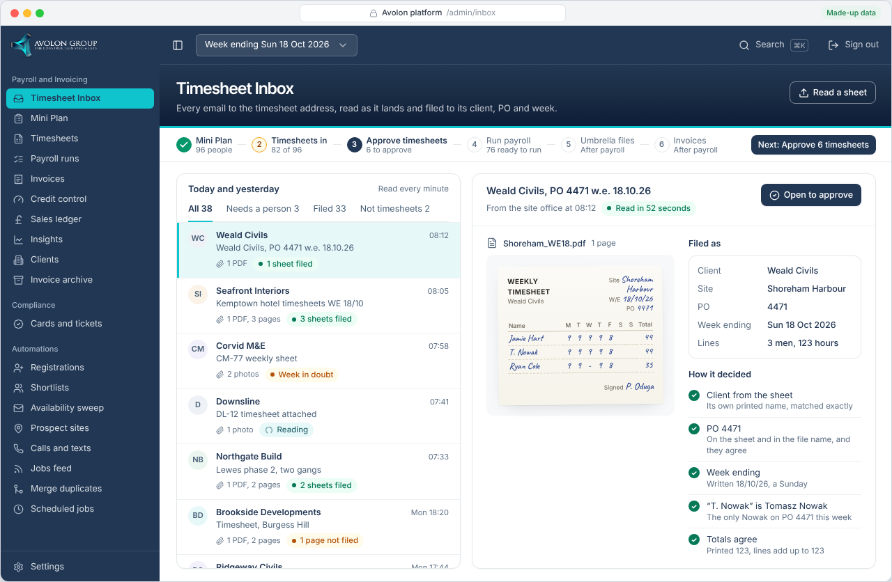
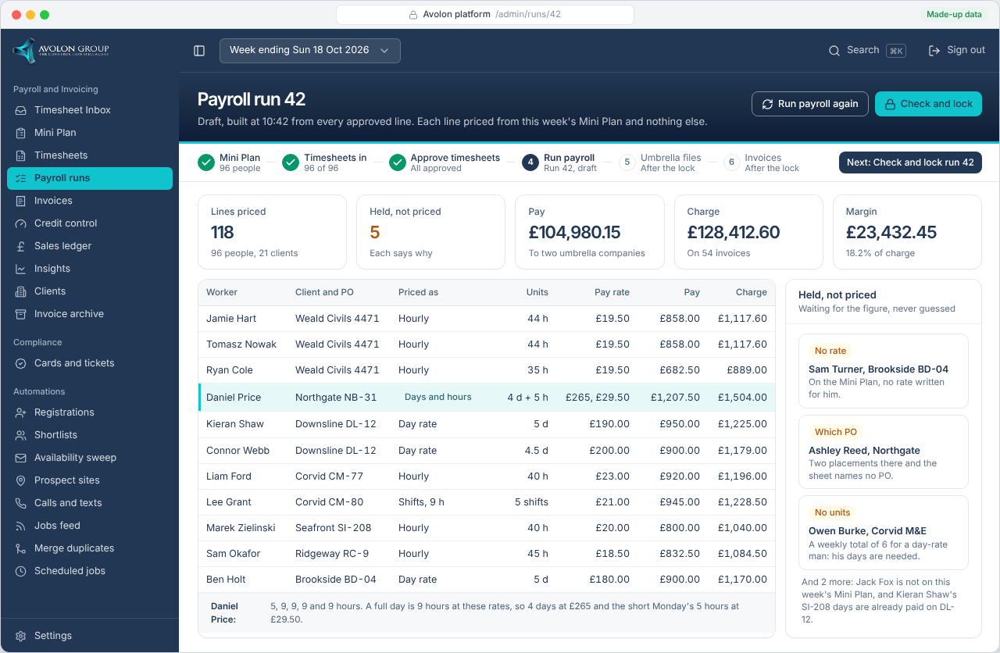
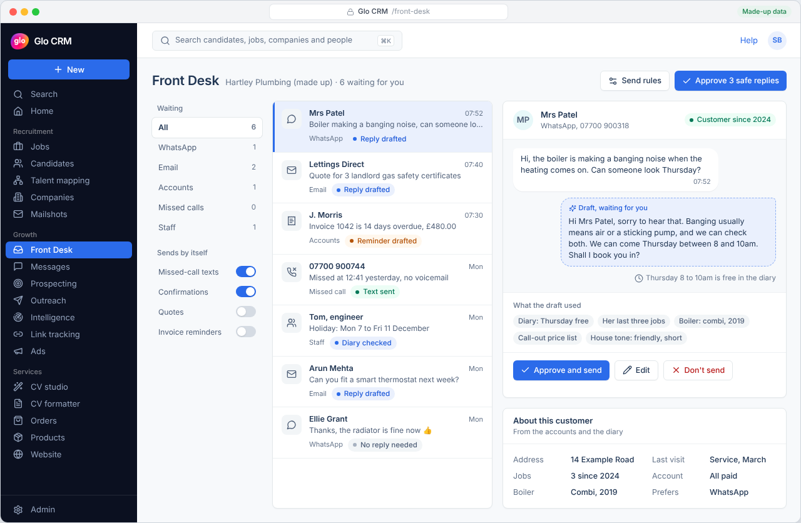
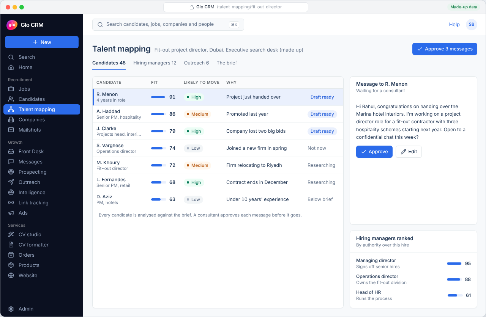

# Recruitment automation showcase

Interactive demos of 45 automations I've built for recruitment agencies and service businesses, each shown in the platform it runs in: reading emailed timesheets, pricing payroll, raising invoices, ranking candidates, outreach queues and CV pipelines.

**[Open the live demo](https://burnsysolutions.github.io/recruitment-automation-showcase/)**

The real systems run on my clients' own data, so nothing here comes from them. Every person, client, site and figure in these demos is made up, and nothing you press sends anything anywhere.



## Shown in the platform each one runs in

Every automation has a screen of the platform it lives in, drawn with that platform's own branding and made-up data:

- **1 to 21: Avolon Group's back office**, the operations platform I built for a construction labour agency alongside Bullhorn. Its own logo, navy and cyan, and its real menu.
- **22 to 45: Glo CRM**, the recruitment CRM I built (JobAdder-style), with the growth, CV and search tools inside it.

| | |
|---|---|
|  |  |
|  |  |

Each demo page also has a step-through of the automation and, for four of them, a hand-built demo you can change: the days and hours pay rule, the Front Desk approval queue, an ATS check and the shortlist weights.

## What's in it

- **45 demos.** Each one says the problem it solves, how it works, which tools it uses and whether it is in use today.
- **A demo back office** (`/crm`) for a fictional construction labour agency. Its data lives in your browser; Settings > Demo data resets it.
- **One real pay rule, with its tests.** [`src/lib/daysAndHours.ts`](src/lib/daysAndHours.ts) is the "days and hours" rule from the payroll engine I built: a man with a day rate and an hourly rate is paid a day for each full day and by the hour for the rest. Its [tests](src/lib/daysAndHours.test.ts) pin down the worked examples and the edge cases: every hour paid exactly once, impossible hours refused rather than guessed. The rates in them are made up.

## What "In use" means

- **In use**: running in a client's business today.
- **Built**: built and working, not in daily use by a client.
- **Built, not switched on**: built, with the switch that sends messages left off by the client.

The only results quoted are ones I can stand behind: 1,478 candidates asked for their availability and 115 Bullhorn records updated in 7 weeks with no consultant time; 63,000+ candidates and nearly 130,000 CV files recovered into a new recruitment CRM; duplicate client records merged from 62 to 38; 2,784 AI candidate analyses for an executive search desk.

## The 45 automations

### Timesheets to invoices (Avolon Group, construction recruitment)

| # | Automation | What it does | Status |
|---|---|---|---|
| 1 | [Timesheet inbox that reads itself](https://burnsysolutions.github.io/recruitment-automation-showcase/#/demo/timesheet-inbox) | Emailed timesheets read by AI within minutes, filed to the right client, PO and week. | In use |
| 2 | [Timesheet checks before anyone is paid](https://burnsysolutions.github.io/recruitment-automation-showcase/#/demo/timesheet-checks) | Totals, unreadable writing, duplicates and the wrong week caught before approval. | In use |
| 3 | [Weekly plan upload and chase board](https://burnsysolutions.github.io/recruitment-automation-showcase/#/demo/mini-plan) | One spreadsheet sets the week's rates and who should send a sheet; missing sheets get chased. | In use |
| 4 | [Payroll engine](https://burnsysolutions.github.io/recruitment-automation-showcase/#/demo/payroll-engine) | One rule book prices every line: day rates, hourly, shifts, and days plus hours. Anything it can't price is held. | In use |
| 5 | [Umbrella company batch file](https://burnsysolutions.github.io/recruitment-automation-showcase/#/demo/umbrella-file) | The weekly pay file built in the umbrella company's own layout, straight from the run. | Built |
| 6 | [Invoices with the signed timesheets attached](https://burnsysolutions.github.io/recruitment-automation-showcase/#/demo/invoices) | One invoice per client, PO and week, with the signed sheets from page 2. Void and credit note built in. | In use |
| 7 | [Checks on every run before money moves](https://burnsysolutions.github.io/recruitment-automation-showcase/#/demo/run-checks) | 15 invoice checks and 9 payroll checks. A problem stops only the item at fault. | In use |
| 8 | [Sales ledger, statements, credit control and charts](https://burnsysolutions.github.io/recruitment-automation-showcase/#/demo/ledger) | Who owes what and how old it is, client statements as PDF, and the clients closest to their limit. | In use |
| 9 | [Old invoicing history, side by side](https://burnsysolutions.github.io/recruitment-automation-showcase/#/demo/old-invoices) | Years of invoices from the previous system kept apart, and set beside the new figures week by week. | In use |
| 10 | [Clients: terms, credit and clean records](https://burnsysolutions.github.io/recruitment-automation-showcase/#/demo/clients) | Payment terms that set due dates, credit limits, and duplicate clients merged safely. | In use |
| 11 | [Weekly check against the owner's own figures](https://burnsysolutions.github.io/recruitment-automation-showcase/#/demo/weekly-check) | Each man's hours from the platform set beside the owner's spreadsheet, every week of the test run. | In use |

### Candidates and Bullhorn (Avolon Group)

| # | Automation | What it does | Status |
|---|---|---|---|
| 12 | [Website registrations straight into Bullhorn](https://burnsysolutions.github.io/recruitment-automation-showcase/#/demo/registrations) | Sign-ups pushed into the CRM every hour with their documents and consents attached. | In use |
| 13 | [A ranked shortlist for every new vacancy](https://burnsysolutions.github.io/recruitment-automation-showcase/#/demo/shortlists) | Within the half hour of a job going on Bullhorn, a ranked shortlist lands in the inbox. | In use |
| 14 | [Database cleaning: are you free for work?](https://burnsysolutions.github.io/recruitment-automation-showcase/#/demo/availability) | Dormant candidates get a one-tap availability link, and the answer goes back into Bullhorn. | In use |
| 15 | [Prospect alerts](https://burnsysolutions.github.io/recruitment-automation-showcase/#/demo/prospect-alerts) | The team is told when a suitable worker becomes available near a site they want to win. | Built |
| 16 | [Compliance: cards read by AI](https://burnsysolutions.github.io/recruitment-automation-showcase/#/demo/compliance) | Card photos read by AI, expiry dates tracked, and a renewal page for workers. | In use |
| 17 | [AI voice caller for availability](https://burnsysolutions.github.io/recruitment-automation-showcase/#/demo/ai-caller) | An AI voice agent phones candidates to ask if they're free, and writes the answer back. | Built, not switched on |
| 18 | [Text replies and STOP handling](https://burnsysolutions.github.io/recruitment-automation-showcase/#/demo/sms) | Two-way texts: replies filed on the record, STOP honoured at once. | Built, not switched on |
| 19 | [Jobs feed for Google and Indeed](https://burnsysolutions.github.io/recruitment-automation-showcase/#/demo/jobs-feed) | Live jobs as proper pages with structured data, a sitemap and job alerts. | Built |
| 20 | [Worker matching that never guesses](https://burnsysolutions.github.io/recruitment-automation-showcase/#/demo/worker-matching) | Names on sheets matched to the right person, strictly; duplicates merged safely. | In use |
| 21 | [Every automation on one screen](https://burnsysolutions.github.io/recruitment-automation-showcase/#/demo/scheduler) | Each scheduled job, when it last ran and what it said. | In use |

### Sales and site intelligence (Glo Business Solutions)

| # | Automation | What it does | Status |
|---|---|---|---|
| 22 | [Front Desk: one inbox, replies drafted, you approve](https://burnsysolutions.github.io/recruitment-automation-showcase/#/demo/front-desk) | Email, WhatsApp, accounts and missed calls in one queue, with a reply drafted for each. | Built |
| 23 | [Business development autopilot](https://burnsysolutions.github.io/recruitment-automation-showcase/#/demo/bd-autopilot) | Finds local businesses, checks them, scores them and drafts outreach inside the rules. | Built |
| 24 | [Email domain health](https://burnsysolutions.github.io/recruitment-automation-showcase/#/demo/domain-health) | Checks the sending domain is set up properly before a single email goes out. | Built |
| 25 | [LinkedIn outreach queue](https://burnsysolutions.github.io/recruitment-automation-showcase/#/demo/linkedin-queue) | Connection requests and messages worked through within daily caps, with accepts tracked. | Built |
| 26 | [Buying-intent finder](https://burnsysolutions.github.io/recruitment-automation-showcase/#/demo/intent-finder) | Spots public posts from business owners asking for help, before anyone else replies. | Built |
| 27 | [Trades & Labour Intelligence](https://burnsysolutions.github.io/recruitment-automation-showcase/#/demo/site-intelligence) | Construction sites about to start, the firms on them and who to call, before the competition. | Built |
| 28 | [Tracked proposal and demo links](https://burnsysolutions.github.io/recruitment-automation-showcase/#/demo/tracked-links) | Each prospect gets their own link; you get told who opened what, and for how long. | Built |
| 29 | [Portfolio and film tracking](https://burnsysolutions.github.io/recruitment-automation-showcase/#/demo/portfolio-tracking) | Which pages and videos employers and clients actually watch. | Built |
| 30 | [Product demand research](https://burnsysolutions.github.io/recruitment-automation-showcase/#/demo/demand-research) | Marketplace, social and supplier data scored to choose a product to sell. | Built |
| 31 | [Dropshipping system](https://burnsysolutions.github.io/recruitment-automation-showcase/#/demo/dropshipping) | Supplier stock, marketplace listings, price checks and order tracking, with a daily digest. | Built |
| 32 | [WhatsApp, Gmail and ad conversion connections](https://burnsysolutions.github.io/recruitment-automation-showcase/#/demo/connections) | Messages sent and received through WhatsApp and Gmail, and sales reported back to Meta. | Built |

### CVs and headhunting (Glo Career Services and executive search)

| # | Automation | What it does | Status |
|---|---|---|---|
| 33 | [AI CV pipeline: generate, audit, fix](https://burnsysolutions.github.io/recruitment-automation-showcase/#/demo/cv-pipeline) | A CV written to a set method, checked against it, and fixed before a person signs it off. | Built |
| 34 | [Cover letters and gap analysis](https://burnsysolutions.github.io/recruitment-automation-showcase/#/demo/gap-analysis) | Questions sent to the client about what's missing; their answers built into the CV. | Built |
| 35 | [Free CV review that wins clients](https://burnsysolutions.github.io/recruitment-automation-showcase/#/demo/free-cv-review) | Upload a CV, get an honest review in minutes, with follow-ups by email and WhatsApp. | Built |
| 36 | [CV formatter for recruitment agencies](https://burnsysolutions.github.io/recruitment-automation-showcase/#/demo/cv-formatter) | Candidate CVs turned into the agency's branded format in seconds, on a subscription. | Built |
| 37 | [ATS check and tailoring](https://burnsysolutions.github.io/recruitment-automation-showcase/#/demo/ats-check) | How well a CV matches a job description, what's missing, and a tailored version. | Built |
| 38 | [Pay first, delivered automatically](https://burnsysolutions.github.io/recruitment-automation-showcase/#/demo/checkout) | Payment taken, account created, and the order started without anyone touching it. | Built |
| 39 | [WhatsApp AI auto-reply with staff takeover](https://burnsysolutions.github.io/recruitment-automation-showcase/#/demo/whatsapp-ai) | Common questions answered on WhatsApp straight away, and a person can take over at any point. | Built |
| 40 | [Headhunting engine for executive search](https://burnsysolutions.github.io/recruitment-automation-showcase/#/demo/headhunting) | Finds candidates, weighs how likely each is to move, ranks hiring managers, drafts outreach for approval. | Built |
| 41 | [Search candidates by meaning](https://burnsysolutions.github.io/recruitment-automation-showcase/#/demo/zoho-search) | Find people in the ATS by what they've done, not just the exact words on their CV. | Built |
| 42 | [Jobs, hiring signals and salary data](https://burnsysolutions.github.io/recruitment-automation-showcase/#/demo/ingestion) | Construction jobs, company news and salary data gathered so the desk knows who's hiring. | Built |
| 43 | [Inbox AI that drafts replies](https://burnsysolutions.github.io/recruitment-automation-showcase/#/demo/gmail-ai) | Reads the inbox, sorts what matters and drafts replies ready to send. | Built |
| 44 | [Ad tracking, lead forms and audiences](https://burnsysolutions.github.io/recruitment-automation-showcase/#/demo/ad-tracking) | Sales and leads reported to Meta and TikTok from the server; lead forms straight into the system. | Built |
| 45 | [Search visibility](https://burnsysolutions.github.io/recruitment-automation-showcase/#/demo/search-visibility) | Sitemap, instant indexing and a steady feed of career articles. | Built |

## How it's built

Vite, React 18, TypeScript and Tailwind. No server: every demo runs in the browser on fixed, made-up data, and the site is served from GitHub Pages with hash routing so every link opens directly.

The platform screens are live React, not pictures: one small kit (tables, tiles, charts, documents) drawn in each platform's own design tokens, taken from the two products' code. Each screen is laid out at 1280 by 800 and scaled to fit, so it stays sharp at any size. `tools/thumbs.mjs` makes the card images from the same screens.

The production systems behind these demos use Supabase (Postgres, edge functions, scheduled jobs), Bullhorn's REST API, Claude and other AI models for reading documents and drafting, Twilio, Brevo, WhatsApp Cloud API, Stripe and Cloudflare Workers.

## Run it locally

```sh
npm install
npm run dev     # http://localhost:5173
npm test        # the pay rule's unit tests
npm run build
```

## About me

Scott Burns. 25 years in recruitment, now building the automation and AI systems that recruitment and service businesses run on.

- Portfolio: https://globusinesssolution.com/portfolio
- GitHub: https://github.com/burnsysolutions
